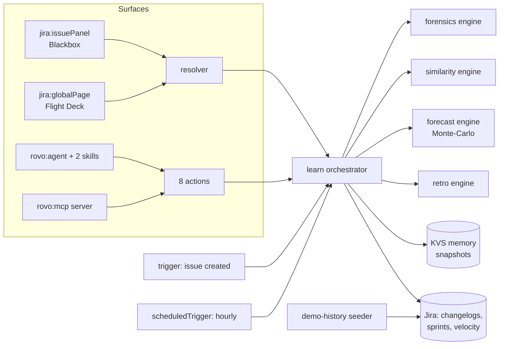

# 🔭 Atlassian Blackbox

**The AI flight recorder for software teams.** A Forge app for Codegeist 2026
that treats every sprint like a flight: records what actually happened
(forensics), learns from the crashes, near-misses and wins (retro + memory),
recognizes when today's work resembles yesterday's incident (déjà-vu), and
forecasts whether this sprint will make it — by replaying your own history
10,000 times (Monte-Carlo).

> Teams don't repeat failures because they're careless. They repeat them
> because the lessons evaporate. Blackbox is the recorder that never forgets.

## Judge quick path (fresh site, 60 seconds)

> **Install → Jira → Apps → Blackbox → "Generate demo history" → "Learn this board".**
> The seeder creates the `BBD` project with **three closed sprints of realistic
> history** — crashes that breached their due dates, near-misses that landed
> heavy, clean wins — plus a live sprint whose open items are engineered to
> resemble the past crashes. One click later, Blackbox shows:
> the déjà-vu flags ("PROJ-42 resembles PROJ-12, which breached"), the
> Monte-Carlo forecast, and a GO/NO-GO preflight. **No app on the marketplace
> demos this way.**

## What it does

| Surface | Module | What the user gets |
|---|---|---|
| **Flight Deck** (Jira global page) | `jira:globalPage` | 🚦 Learn tab: preflight verdict, on-time probability meter, p50/p85/p95 forecast chart, déjà-vu list, heaviest recordings · 📼 Retro tab: evidence-based retro of the last sprint · 🧠 Memory tab: snapshot trend |
| **Blackbox panel** (issue view) | `jira:issuePanel` | The issue's flight recording: forensic findings with evidence, silence windows, déjà-vu matches, one-click follow-up |
| **Blackbox agent** | `rovo:agent` + 2 `rovo:skill`s | 8 actions: learn, examine, forecast, déjà-vu, retro, preflight (+ gated create/annotate) |
| **MCP server** | `rovo:mcp` | All 8 tools for Rovo Studio custom agents and third-party MCP clients |
| **Continuous memory** | `scheduledTrigger` + `trigger` | Hourly relearn (KVS-persisted snapshots for trends) |

## The engines (all pure, all unit-tested — 57 tests)

| Engine | What it does | Key outputs |
|---|---|---|
| **Forensics** | Replays each issue's changelog as a timeline: silence windows, late scope churn, estimate creep, handoff churn, escalations | `silent-stall`, `late-scope-churn`, `estimate-creep`, `handoff-churn`, `escalated`, `duedate-breach` |
| **Similarity** | TF-weighted cosine over issue text; ranks which past items resemble today's work and weighs their outcomes | déjà-vu matches with shared terms + historical risk 0..1 |
| **Forecast** | Monte-Carlo (seeded PRNG, reproducible): replays your own daily throughput distribution thousands of times | on-time probability, p50/p85/p95 completion in working days |
| **Retro** | Classifies the last sprint into crashed / near-misses / wins; extracts repeating patterns as lessons | evidence-based retro + lessons with occurrence counts |
| **Preflight** | Combines forecast + déjà-vu into the commit decision | GO / GO-WITH-CAUTION / NO-GO with cited reasons |

## Architecture



Every engine is pure and deterministic (the forecast even uses a seeded
PRNG so numbers are reproducible). All I/O lives at the edges. The agent is
read-only by default; CREATE/UPDATE actions are gated behind explicit user
confirmation in the prompt and both skill playbooks.

## Quick start

```bash
npm install -g @forge/cli@latest
npm install
forge register        # first time only; put your app id in manifest.yml
forge deploy
forge install         # on your site, e.g. your-site.atlassian.net
```

Then open Jira → Apps → Blackbox. On an empty site, click **Generate demo
history** and learn.

## Testing

```bash
npm test              # 57 unit tests across 5 suites (incl. an integration
                      # test over mocked history: learn → déjà-vu → retro)
```

## License

Apache-2.0
